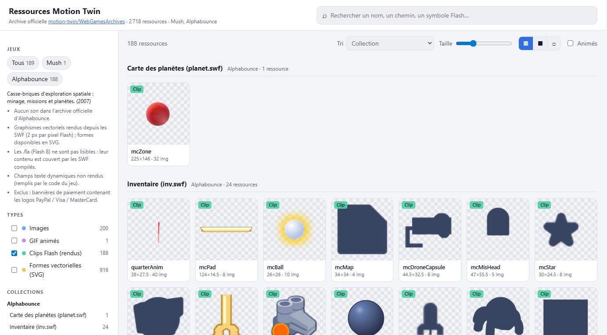
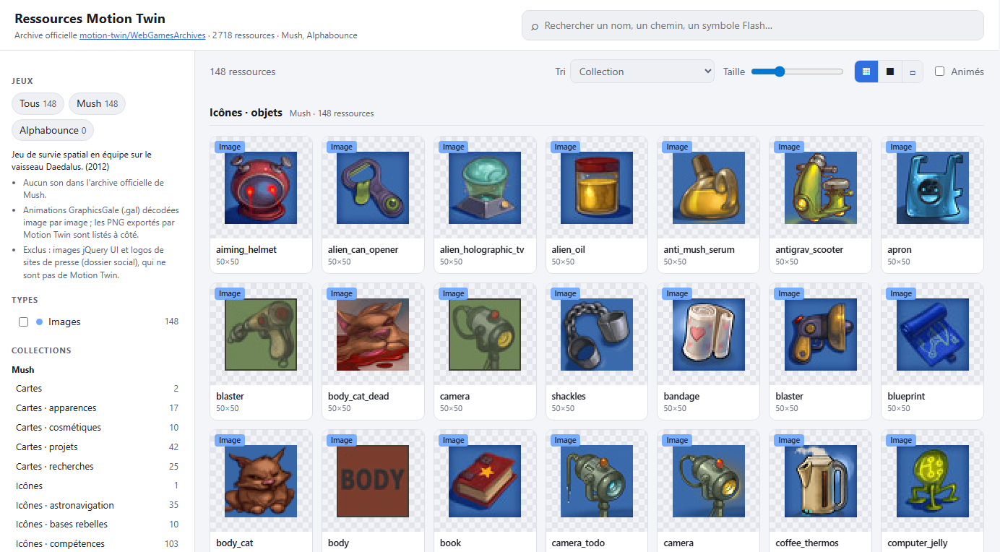

# MotionTwin-Ressource

Page web locale pour parcourir les **ressources graphiques et sonores officielles des jeux Motion Twin**, telles que
Motion Twin les a publiées dans son archive [motion-twin/WebGamesArchives](https://github.com/motion-twin/WebGamesArchives)
(licence CC BY-NC-SA 4.0). Uniquement du matériel d'origine : rien de refait après coup (pas de remake, pas de création
de fans), et les éléments tiers présents dans l'archive (images jQuery UI, logos de presse, logos de paiement) sont exclus.

Jeux : **Mush** (2012), **Alphabounce** (2007), **Galaxy55** (alpha, 2012) et sept jeux Muxxu : **Kube** (2010),
**Kingdom** (2009), **CroqueMotel** (2011), **Intrusion** (2009), **La Brute** (2010), **Odyssey** (2011) et
**Snake** (2010).



## Contenu

| Jeu | Images | GIF animés | Animations GraphicsGale | Clips Flash rendus | Formes vectorielles (SVG) | Sons |
|---|---:|---:|---:|---:|---:|---:|
| Mush | 3 652 | 22 | 50 | 1 | 3 | 0 |
| Alphabounce | 229 | 1 | 0 | 187 | 1 679 | 0 |
| Galaxy55 | 462 | 0 | 0 | 0 | 0 | 12 |
| Kube | 291 | 2 | 0 | 12 | 35 | 0 |
| Kingdom | 632 | 6 | 0 | 33 | 156 | 0 |
| CroqueMotel | 467 | 0 | 0 | 84 | 318 | 0 |
| Intrusion | 459 | 1 | 0 | 50 | 248 | 49 |
| La Brute | 162 | 0 | 0 | 40 | 906 | 0 |
| Odyssey | 640 | 1 | 0 | 381 | 6 277 | 0 |
| Snake | 1 030 | 0 | 5 | 4 | 6 | 0 |

Galaxy55 a aussi **3 modèles 3D** (cosmonaute, foreuse, porte ouverte) et **12 réglages de son LabChirp**. Ses planches
(`texture.png`, `tiles.png`, `icons.png`) sont découpées en morceaux aux pixels d'origine, nommés d'après le tableur et le
code du jeu (250 tuiles de blocs) ; les repères de travail peints par Motion Twin dans la planche des blocs ne sont pas
des ressources. Seuls les fichiers publiés par Motion Twin sont montrés, pas les blocs ni les textures ajoutés depuis
par les portages du jeu.

Seuls Galaxy55 (12 bruitages WAV) et Intrusion (49 sons MP3) ont des sons dans l'archive officielle.
Les fichiers sources `.fla` sont lus aussi : symboles en SVG (composés entiers pour les `.fla` XFL d'Odyssey,
formes propres de chaque symbole pour les `.fla` binaires), bitmaps ; voir docs/METHODE.md §5.9.
Pour Kube, les captures de constructions de joueurs (événements de la communauté) ne sont pas montrées.

La page permet de :
- chercher par nom, chemin dans l'archive, nom de symbole Flash ou étiquette d'animation (sans tenir compte des accents) ;
- filtrer par jeu, type et collection (compteurs à jour selon les autres filtres) et trier (collection, nom, taille,
  nombre d'images, poids) ;
- régler la taille des miniatures et le fond (damier, sombre, clair) ; les animations se jouent au survol ;
- tourner autour des modèles 3D (glisser, molette, double-clic) et écouter le son associé à un réglage LabChirp ;
- ouvrir une fiche : zoom (ajusté, 1× à 8×, Ctrl + molette), lecture image par image, vitesse, métadonnées (dimensions,
  images, SWF, n° de caractère, étiquettes, clips qui utilisent une forme), doublons dans l'archive, téléchargements
  (fichier, SVG, planche d'animation, image courante), attribution prête à copier, lien vers le fichier source sur GitHub ;
- partager l'état de la page : filtres, recherche et ressource ouverte sont dans l'adresse (`#jeu=mush&q=…&res=…`).



## Afficher la page

Il faut seulement Git et Python 3.11 ou plus. Le catalogue (`catalog.js`) et les fichiers dérivés (`gen/`) sont versionnés ;
seules les images de l'archive Motion Twin sont à récupérer (sparse checkout des dossiers des jeux, environ 300 Mo) :

```bash
git clone https://github.com/Cornor923/MotionTwin-Ressource.git
cd MotionTwin-Ressource
python tools/rebuild.py --fetch
python tools/serve.py
```

Puis ouvrir http://127.0.0.1:8642/. Ouvrir `index.html` directement (double-clic) marche aussi, sauf le bouton
« Image courante (PNG) » (le navigateur interdit de lire un canvas en `file://`). `serve.py` désactive le cache du
navigateur, utile après une reconstruction du catalogue.

## Reconstruire le catalogue ou ajouter un jeu

```bash
python -m venv .venv
.venv/Scripts/pip install -r requirements.txt      # Linux / macOS : .venv/bin/pip
# FFDec + Java : dans .tools/ (ignoré par git) ou via FFDEC_TOOLS / FFDEC_JAR, voir docs/METHODE.md
.venv/Scripts/python tools/rebuild.py
```

La première reconstruction complète prend environ 45 minutes (rendu des clips de `game.swf` d'Alphabounce) ; ensuite
seuls les SWF nouveaux sont exportés et rendus. Pour ajouter un jeu : une entrée dans [games.json](games.json), puis
`rebuild.py`. Tout le détail (méthode, choix, formats, limites, dépannage) est dans [docs/METHODE.md](docs/METHODE.md).

## Organisation

```
index.html, viewer/        page (HTML/CSS/JS sans dépendance ni compilation)
catalog.js                 catalogue généré (window.MT_CATALOG)
gen/                       fichiers dérivés générés : clips rendus, SVG, bitmaps de SWF, animations .gal décodées
games.json                 configuration des jeux : dossiers, exclusions, SWF, collections, notes
tools/rebuild.py           chaîne complète (archive, FFDec, rendus, catalogue)
tools/build_catalog.py     catalogue + gen/ (avec swf_items.py, gal.py, sheets.py, models.py, presets.py)
tools/sheets.py            découpe des planches (pixels d'origine), galaxy55.py : noms des blocs et repères
tools/models.py            modèles 3D (.bae, .md) : maillage, OBJ, aperçu (render3d.py)
tools/fla_items.py         symboles, bitmaps et sons des .fla (xfl.py, fla_bin.py, fla_compose.py, vector_svg.py)
tools/fla_decoder/         lecteur des .fla binaires repris de eddiemoore/fla-decoder (MIT), avec tools/olefile/ (BSD)
tools/render_symbols.py    rendu des clips exportés d'un SWF
tools/swf_diff.py          clips qui diffèrent entre deux versions d'un SWF
tools/swf_inventory.py     inventaire rapide des balises d'un SWF (sons, bitmaps, symboles exportés…)
tools/serve.py             serveur local sans cache
tools/flash/               lecteur et compositeur SWF repris de kadokadeo (AGPL-3.0)
docs/METHODE.md            documentation complète
sources/                   archive Motion Twin (récupérée, ignorée par git)
```

## Licence et crédits

Les ressources sont © **Motion Twin**, publiées sous [CC BY-NC-SA 4.0](https://creativecommons.org/licenses/by-nc-sa/4.0/).
Ce dépôt est partagé sous la **même licence** (texte dans [LICENSE](LICENSE)) : pas d'usage commercial, crédit à Motion Twin,
partage dans les mêmes conditions. Exception : `tools/flash/`, repris de [eternaltwin/kadokadeo](https://github.com/eternaltwin/kadokadeo),
reste sous AGPL-3.0. Détails dans [NOTICE](NOTICE). Ce projet n'est ni affilié à Motion Twin ni approuvé par Motion Twin.
